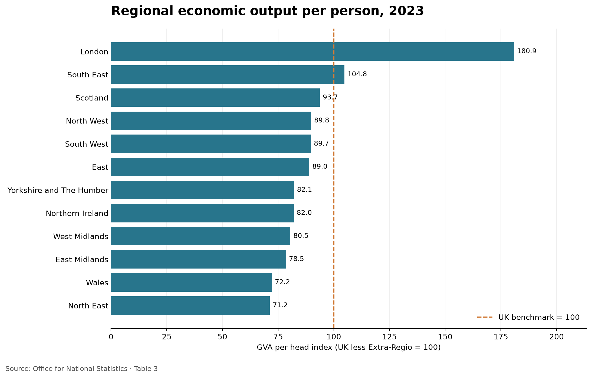

# UK Regional GVA Visualisation

## Abstract

This project looks at how economic output per person differs across UK regions and nations, using Office for National Statistics (ONS) data for 2023. I made a bar chart in Python that compares each area with the UK average, so the gaps between regions are easy to see at a glance. London is well above the UK benchmark and the North East is well below it. These figures measure economic output, not household income, so they should be read with some care.

## Introduction

People often talk about regional inequality in the UK, but it's not always clear what is being compared. This project looks at one measure, gross value added (GVA) per head, which is roughly the value of the goods and services produced in an area divided by the number of people living there. I wanted to turn it into something clear and easy to read, rather than a large table of numbers.

## Data and definitions

The data comes from **Table 3** of the ONS regional gross value added spreadsheet, which is included in this repository. I used the most recent year available, 2023.

**GVA per head** is the value of an area's economic output divided by its population. Table 3 shows it as an index, where the UK figure (excluding Extra-Regio) is set at 100. A region above 100 produces more per person than the UK benchmark, and a region below 100 produces less.

I used the broad ITL1 areas, which are the regions of England plus Scotland, Wales and Northern Ireland. I chose these because they make the clearest comparison and keep the chart readable.

## Method

I wrote a short Python script (`chart.py`) that does the following:

- reads Table 3 from the spreadsheet with pandas
- selects the ITL1 regions and nations
- finds the latest year with data
- draws a horizontal bar chart in matplotlib, with a dashed line at the UK benchmark of 100
- saves the result as `regional_gva_chart.png`

## Results

London has the highest index at **180.9**, which means output per person is about 81% above the UK benchmark. The North East has the lowest at **71.2**, about 29% below it. That is a big gap between the top and bottom of the chart, and it shows how unevenly economic output is spread across the country.

## Limitations

GVA per head is **not** a measure of household income or living standards, and it's easy to read it that way by mistake. The main limitations are:

- **Commuting.** GVA is counted where the work is done, but the population is counted where people live. If lots of people commute into London, its figure gets pushed up, and other regions can look lower for the same reason.
- **Broad regions.** ITL1 areas hide a lot of variation inside them. A region can contain both very productive and very struggling local areas.
- **One year only.** This is a snapshot of 2023, so it can't show whether the gaps are getting bigger or smaller over time.
- **Index values.** Everything is relative to the UK benchmark, so the chart shows how regions compare with each other, not how much output there actually is.
- **Revisions.** The ONS can revise its estimates, so the figures may change in later releases.

## Running the project

You need Python and the packages **pandas**, **openpyxl** and **matplotlib**. Install them with:

`pip install pandas openpyxl matplotlib`

Keep the spreadsheet in the same folder as `chart.py`, then run:

`python chart.py`

The chart will be saved in the same folder. The script opens it automatically on a Mac.

## Possible extensions

- showing several years, to see how the gaps have changed
- adding household income data, so output and income can be compared directly
- using smaller regional areas (ITL2 or ITL3) to show differences within regions

## Source

Office for National Statistics, *Regional gross value added (balanced) per head and income components*, Table 3.
